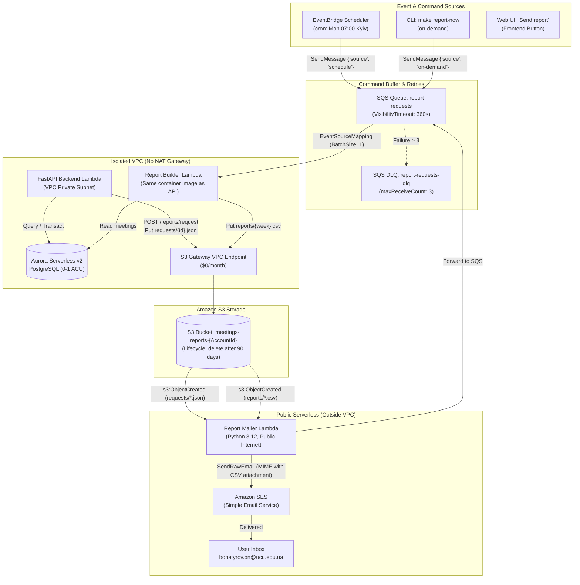

# Lab 5: A Weekly Report, Built by Events

> **Project:** Meetings App (`OneTwoThree`)  
> **Course:** Object-Oriented Analysis & Design / Cloud Architecture  
> **Target Account Email:** `bohatyrov.pn@ucu.edu.ua`  
> **Frontend Demo:** `https://d18n2l5wknn4cc.cloudfront.net/`  
> **Architecture Pattern:** Decoupled Event-Driven Architecture (EDA) on AWS Serverless (EventBridge Scheduler, SQS + DLQ, VPC Lambda with S3 Gateway Endpoint, S3 Notifications, SES Mailer Lambda).

---

## 1. Architectural Overview & Design Decisions

### Target Architecture Diagram



---

## 2. Why Two Functions and Not One? (Architectural Rationale)

In our project architecture (from Lab 4), the backend and database operate inside a **private VPC without a NAT Gateway** to keep the infrastructure strictly at **$0/month** (NAT Gateways cost ~$32.40/month per Availability Zone). 

Because the VPC has no NAT:
1. **The Builder Lambda** must reside in the private VPC to query the Aurora Serverless v2 database cluster. It accesses Amazon S3 via an **S3 Gateway VPC Endpoint**, which is completely free and routes directly through the AWS private network. However, it cannot connect to the public internet or Amazon SES.
2. **The Mailer Lambda** resides outside the VPC. It does not touch the database, but has native internet access to invoke Amazon SES and Amazon S3.
3. **Decoupling via S3 Events:** The Builder does not call the Mailer directly. Instead, when the Builder uploads `reports/{week}.csv` to S3, an S3 `ObjectCreated:*` event triggers the Mailer Lambda. This makes the architecture strictly event-driven: new subscribers (such as Slack alerts or archiving) can be added without modifying a single line of Builder code.

---

## 3. Stretch Goal Implementation: Option 3 (Request File via S3 Gateway Endpoint)

### Stretch Goal Justification Paragraph
> *"We implemented the on-demand report request button using **Option 3 (Request File via S3 Gateway VPC Endpoint)** to preserve our zero-cost, NAT-free serverless architecture. Rather than provisioning SQS VPC Interface Endpoints (which bill ~$14.40/month across two Availability Zones plus data transfer) or introducing periodic relational database polling with a transactional outbox table, the API drops a lightweight JSON request (`requests/{request_id}.json`) into S3 via the existing free S3 Gateway Endpoint. An S3 `ObjectCreated` event notification immediately triggers our serverless dispatcher running outside the VPC, which pushes the job into the `report-requests` SQS queue. While this pattern introduces a brief file hop in S3, for an asynchronous weekly report delivery that naturally delivers via email within seconds to minutes, it provides the optimal balance: zero operational cost, zero database polling overhead, full backpressure buffering, and unified retry/DLQ error handling."*

---

## 4. Step-by-Step Execution Guide for the User

### Step 1. Verify Email in AWS SES (One-time Manual Step)
1. Open the **AWS Console** in `us-east-1` → navigate to **Amazon SES**.
2. Go to **Identities** → click **Create identity**.
3. Select **Email address**, enter `bohatyrov.pn@ucu.edu.ua`, and click **Create identity**.
4. Check your inbox for the verification email from AWS and click the verification link.
5. In SES Sandbox mode, verified identities can both send and receive emails.

### Step 2. Build and Deploy Backend & Reports Stacks
From your terminal in the workspace root:

```bash
# 1. Verify AWS credentials
make aws-check

# 2. Build and push the updated backend container (includes reports logic)
make aws-backend-push

# 3. Update the backend stack (exports RouteTable and grants S3 permissions)
make aws-backend-stack KEEP_IMAGE=1

# 4. Deploy the Lab 5 Reports Stack (S3, SQS, DLQ, Scheduler, Builder & Mailer Lambdas)
make aws-reports-deploy
```

### Step 3. Generate On-Demand Report (`make report-now`)
Test on-demand report generation:

```bash
# Request report for ISO week 2026-W40
make report-now WEEK=2026-W40
```
Within ~30–60 seconds:
- SQS triggers the Builder Lambda inside the VPC.
- Builder wakes Aurora (if paused), aggregates meeting data, and writes `reports/2026-W40.csv` to S3.
- S3 triggers the Mailer Lambda outside the VPC.
- Mailer downloads the CSV and sends an email via SES to `bohatyrov.pn@ucu.edu.ua` with the CSV attached.

### Step 4. Test Automated Schedule Trigger
To verify the EventBridge Scheduler trigger without waiting until Monday 07:00:
1. Temporarily change the schedule expression in `infra/reports.yaml` to `rate(5 minutes)` or update it via CLI:
   ```bash
   aws scheduler update-schedule \
     --name meetings-weekly-report-schedule \
     --schedule-expression "rate(5 minutes)" \
     --flexible-time-window Mode=OFF
   ```
2. Wait 5 minutes for the schedule to trigger.
3. Revert the schedule back:
   ```bash
   aws scheduler update-schedule \
     --name meetings-weekly-report-schedule \
     --schedule-expression "cron(0 7 ? * MON *)" \
     --schedule-expression-timezone "Europe/Kyiv" \
     --flexible-time-window Mode=OFF
   ```

### Step 5. Test DLQ (Dead-Letter Queue)
1. Trigger a failing report to verify SQS retries and DLQ routing:
   ```bash
   # Sending an invalid ISO week format causes the builder to raise ValueError
   aws sqs send-message \
     --queue-url $(make aws-reports-outputs | grep ReportRequestsQueueUrl | awk '{print $4}') \
     --message-body '{"week": "INVALID-WEEK", "source": "test-failure"}'
   ```
2. After 3 failed attempts (with exponential backoff and visibility timeout), the message lands in `meetings-report-requests-dlq`.
3. Check the DLQ:
   ```bash
   make aws-reports-dlq
   ```

---

## 5. What You Submit (Submission Deliverables Checklist)

| # | Item | How to obtain / Artifact |
|---|---|---|
| **1** | **Commit Link** | Link to the Git commit with `back/app/reports/`, `infra/reports.yaml`, and handlers. |
| **2** | **Email Screenshot** | Screenshot of the email delivered to `bohatyrov.pn@ucu.edu.ua` with `weekly_report_2026-W40.csv` attached. |
| **3** | **S3 Objects Listing** | Run `make aws-reports-ls` (or `aws s3 ls s3://<bucket>/reports/ --recursive`). Must show at least two CSV files. |
| **4** | **3 CloudWatch Log Lines** | Run `make aws-reports-logs`. Shows 3 distinct lines: trigger `schedule`, trigger `sqs`, and trigger `s3`. |
| **5** | **Written Answers** | Complete answers to Part 3, Step 7 and Class Discussion questions (provided below). |

---

## 6. Official Answers to Submission Questions (Part 3, Step 7)

### Question 1: The mailer got the same ObjectCreated event twice, and the person got two identical emails. Where would you store "this report was already sent", and what would the key be?
* **Where to store:**
  1. **Amazon DynamoDB table** (e.g. `report_deliveries`) with a single-table schema and point-in-time TTL (e.g. 90 days matching report lifecycle). DynamoDB provides conditional writes (`attribute_not_exists(report_key)`), guaranteeing that duplicate concurrent event deliveries cannot both succeed.
  2. Alternatively, a tracking table in Aurora PostgreSQL or an S3 metadata tag / marker object (e.g. `reports/{week}.csv.sent`).
* **The key:**
  The key must uniquely identify the target report and the recipient:
  - Partition Key: `report_key` = `reports/{week}.csv` (e.g. `reports/2026-W40.csv`), or compound key `(week, recipient_email)`.
  - Before invoking `ses.send_raw_email`, the Mailer executes a conditional write. If the key already exists, the Lambda logs `Duplicate event detected for report {week}; skipping send` and exits cleanly.

### Question 2: The builder in the VPC could not reach SES. List three ways to fix that, with their monthly cost: a NAT gateway, a VPC interface endpoint for SES, and the split you built. Which would you choose with ten more emails a week? With a million?
* **Three Solutions & Monthly Costs:**
  1. **NAT Gateway:**
     - *Cost:* ~$0.045/hour per gateway (~$32.40/month for 1 AZ, ~$64.80/month for 2 AZs) + $0.045 per GB of data transferred.
     - Provides general outbound internet access from private subnets.
  2. **VPC Interface Endpoint (AWS PrivateLink) for SES (`com.amazonaws.us-east-1.email`):**
     - *Cost:* ~$0.01/hour per AZ (~$7.20/month for 1 AZ, ~$14.40/month for 2 AZs) + $0.01 per GB of data processed.
     - Keeps traffic inside AWS private network without opening the internet.
  3. **The Split Architecture (Event-Driven Decoupling with S3 + Mailer outside VPC):**
     - *Cost:* **$0.00/month fixed cost!** S3 Gateway Endpoints are completely free. The Lambda running outside the VPC has free internet access, and SES charges only $0.10 per 1,000 emails ($0.0001 per email).
* **Which to choose?**
  - **With 10 more emails a week:** Choose **Solution 3 (The Split Architecture)**. Paying $14.40 to $65.00/month in networking overhead to send 10 emails is completely unjustified.
  - **With a million emails a week:** Choose **Solution 2 (VPC Interface Endpoint)** if direct, low-latency synchronous email transmission from within the VPC microservices is required. It provides a secure, managed private link at ~$14.40/month without the broad internet exposure and higher cost of a NAT Gateway. However, for batch asynchronous reporting, the Split Architecture (Solution 3) still scales effortlessly and remains significantly cheaper.

### Question 3: You could send a presigned S3 link instead of an attachment. A presigned URL signed with a Lambda role's temporary credentials stops working when those credentials expire, often within hours. How would you send a link that works for a week?
* **AWS Best Practice Solution:**
  **Amazon CloudFront Signed URLs** using a **CloudFront Key Group / Public-Private Key Pair**:
  - The S3 reports bucket is placed behind CloudFront with Origin Access Control (OAC).
  - The Mailer Lambda signs the link using a private RSA key managed in AWS Secrets Manager or KMS.
  - Unlike IAM STS temporary credentials (which hard-expire within 1 to 12 hours), CloudFront signed URLs are validated directly by CloudFront's edge servers against the configured public key. The URL expiration timestamp can be set to 7 days, 14 days, or any desired duration.
* **Alternative Solutions:**
  1. *IAM User Permanent Credentials:* Generating the S3 Presigned URL using long-lived IAM user access keys (though long-lived access keys are discouraged in security best practices).
  2. *Application Proxy Endpoint:* Sending a permanent application link (e.g. `https://onetwothree.dobosevych.com/reports/download?week=2026-W40`), which authenticates the user session via Cognito and immediately generates a fresh 15-minute presigned S3 redirect on demand.

---

## 7. Class Discussion Questions & Comprehensive Answers

### The Pattern
1. **In the cake shop, what is the command and what is the event? Find both in your lab.**
   - *Command:* A request asking for an action to be performed (targeted to one consumer, can be rejected). In the lab: `BuildWeeklyReport(week=2026-W40)` sent by EventBridge Scheduler or `make report-now` into SQS.
   - *Event:* A notification that a state change has already occurred in the past (broadcast to any number of listeners, or none). In the lab: `s3:ObjectCreated` notification stating `ReportCreated(key=reports/2026-W40.csv)`.
2. **McDonald's returns a receipt number at once. A web API does the same with 202 and a job id. What does the user see while the job is running, and what should they see if it fails?**
   - *While running:* The user sees HTTP `202 Accepted` with a job ID / request ID, a confirmation message (*"Report generation queued; you will receive an email shortly"*), and a progress indicator or spinner.
   - *If it fails:* The user should see a descriptive error notification (*"Report generation failed: unable to process data for requested week"*), with actionable options (*"Retry"*) and a correlation ID for support. In the backend, the message is captured in the DLQ for inspection.
3. **"At least once" means your task can run twice. Which of your steps are idempotent, and which are not?**
   - *Idempotent:* Writing `reports/2026-W40.csv` to S3. Writing the exact same data to the exact same key produces identical system state without side-effects.
   - *Non-Idempotent:* Calling `ses.send_raw_email`. Invoking SES twice sends two distinct emails to the customer's inbox. (Mitigated using the deduplication store described in Step 7, Question 1).
4. **The report reads the database at 07:00 on Monday. A meeting from last week is edited at 07:01. Is the report wrong? What does eventual consistency mean for a weekly report, and for the Spry requirement of "recomputed within 5 minutes of a calendar change"?**
   - The report is not wrong; it represents a consistent point-in-time snapshot as of 07:00 Monday.
   - *Eventual Consistency in Reporting:* Periodic batch reports inherently summarize historical data up to a discrete cut-off timestamp.
   - *Spry 5-minute requirement:* If real-time freshness is required, the architecture switches from a weekly cron schedule to change-data-capture (CDC): any calendar update emits a `MeetingUpdated` event that triggers report invalidation and recomputation within 5 minutes.
5. **You want to add a Slack notification when a report is ready. What do you change in the builder?**
   - **Nothing.** Because the builder emits an event to S3 (`s3:ObjectCreated`). You simply configure an additional event subscriber (e.g. an Amazon SNS topic, an EventBridge rule on S3 events, or an additional Lambda function) to post to Slack. The builder remains completely unaware of Slack's existence.

### Self-Hosted Alternatives
1. **A payment service sends an event for every successful payment, and losing one means a customer paid for nothing. Redis or RabbitMQ?**
   - **RabbitMQ.** RabbitMQ guarantees durability (messages written to disk, persistent queues), explicit publisher confirms, and consumer acknowledgments (ack/nack). If a worker crashes before completing work, unacknowledged messages are automatically requeued. In Redis (via simple lists), `RPOP` or `LPOP` removes the message before work is verified; a worker crash loses the message unless complex Redis Streams with pending entries lists (PEL) are configured.
2. **RQ stores the job as a pickled Python call. What happens to the jobs in the queue when you rename the task function and deploy? What does that tell you about message formats between services?**
   - The worker crashes with `AttributeError` or `ModuleNotFoundError` when attempting to unpickle the non-existent function name, causing all queued jobs to fail.
   - *Takeaway:* Service-to-service communication should never rely on language-specific binary serialization (pickle). Payloads must use standardized, versioned, language-agnostic contracts (such as JSON or Protocol Buffers) containing structured data parameters rather than executable code paths.
3. **Celery beat runs schedules in a separate process. What happens if you run two copies of it? What is the AWS equivalent of beat, and why does it not have this problem?**
   - Running two instances of Celery beat causes **duplicate task scheduling**: both instances trigger the schedule, resulting in duplicate jobs queued every period.
   - *AWS Equivalent:* **Amazon EventBridge Scheduler**. AWS manages the scheduler as a highly available, globally synchronized distributed service with built-in leader election and execution guarantees, preventing duplicate triggers.

### AWS Deep Dive
1. **Why does the schedule send a message to SQS instead of invoking the function directly? Name a case where invoking directly is the better choice.**
   - *Why SQS:* Retries, backpressure management (buffering spikes against concurrency limits), dead-letter queues (DLQ) for failed messages, and a unified entry point for both scheduled and on-demand runs.
   - *When direct invoke is better:* Low-latency synchronous tasks that do not touch database connection pools and where the caller immediately needs the result (e.g. an internal health check or a lightweight cache warmup).
2. **Why must the SQS visibility timeout be longer than the function timeout? Describe exactly what goes wrong if it is shorter.**
   - The visibility timeout hides an in-flight message while a worker is processing it. If the function timeout is 60 seconds but visibility timeout is only 30 seconds: after 30 seconds, SQS makes the message visible again to other consumers while the first Lambda execution is still running. A second Lambda instance will pick up the same message, duplicating processing, database contention, and double-execution.
3. **A message lands in the DLQ on Sunday night. Who finds out, and how? Design the alarm.**
   - Create an Amazon CloudWatch Metric Alarm on `AWS/SQS` metric `ApproximateNumberOfMessagesVisible` for `meetings-report-requests-dlq`:
     - Threshold: `> 0` for 1 evaluation period of 1 minute.
     - Alarm Action: Send notification to an Amazon SNS Topic `ops-critical-alerts`.
     - SNS subscribers: DevOps on-call team via email, SMS, or PagerDuty/Opsgenie webhook.
4. **The builder wakes Aurora up every Monday. What does that cost per month, using the numbers from Lab 4? What would it cost if the builder ran every five minutes instead?**
   - *Running once a week:* Aurora resumes for ~5–15 minutes (0.5 ACU minimum). 4 weeks × 15 min = 1 hour/month of 0.5 ACU (~$0.06/hour = **~$0.06/month**).
   - *Running every 5 minutes:* Aurora Serverless v2 has an auto-pause delay of 5 minutes (`SecondsUntilAutoPause: 300`). Running every 5 minutes prevents Aurora from ever pausing! It runs 24/7 (730 hours/month × 0.5 ACU × $0.06/ACU-hour = **~$21.90/month**).
5. **EventBridge Scheduler, SQS and S3 notifications are each nearly free at this volume. SES is $0.10 per thousand emails. At what point does this design start to cost money, and which part first?**
   - The first component that incurs significant cost as scale grows is **Aurora Serverless v2 capacity and storage**, followed by **Amazon SES** at massive scale ($100 per 1 million emails). At low to medium volume, the architecture remains effectively within the AWS Free Tier ($0/month).

